## Hey, I'm Cam 👋

🔭 Statistician, developer and digital leader based in North East England.

⚡ Interested in open data, open-source software and making information more accessible and useful.

💻 Still enjoy getting hands-on with code, mostly in R, Python and TypeScript.

💬 Always happy to talk about tidy data, data visualisation, accessibility, APIs and R Shiny.

🔎 Have a look at [dfe-analytical-services](https://github.com/dfe-analytical-services)

 

 

GitHub statistics provided using [GitHub Readme Stats](https://github.com/anuraghazra/github-readme-stats). **languages only covers my public repositories, excludes forks, contributions in other organisations, and presentation repositories*
